

<h1 align="center">Caddie</h1>

One menu bar app for your Mac, many small tools.

  <a href="https://github.com/blackboxprojects/caddie/releases/latest/download/Caddie.dmg"><b>⬇ Download Caddie for macOS</b></a> 
  Free · macOS 14 or later · Apple silicon

Caddie replaces a drawer full of single-purpose utilities with one app in your menu bar. A dock, a menu bar tidier, a Dynamic Island around the notch, window snapping, clipboard history, screenshots, a window switcher, a security monitor, an app uninstaller and more, all in one place. Every feature starts switched off: turn on the ones you want and leave the rest alone.

## Features

Click a feature to see what it does.

### Layout

<b>Desktop &amp; Dock</b> · a dock of your own, with window previews

 
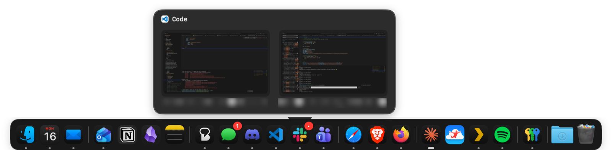
<ul><li>A replacement dock you can put on any screen edge, on the main display, the display under the pointer, a chosen display or every display.</li><li>Hover an app to preview its windows.</li><li>Can hide Apple's Dock; the original settings are saved and put back when you turn the option or the feature off, or quit.</li></ul>

<b>Menu Bar</b> · tuck icons behind an arrow

 
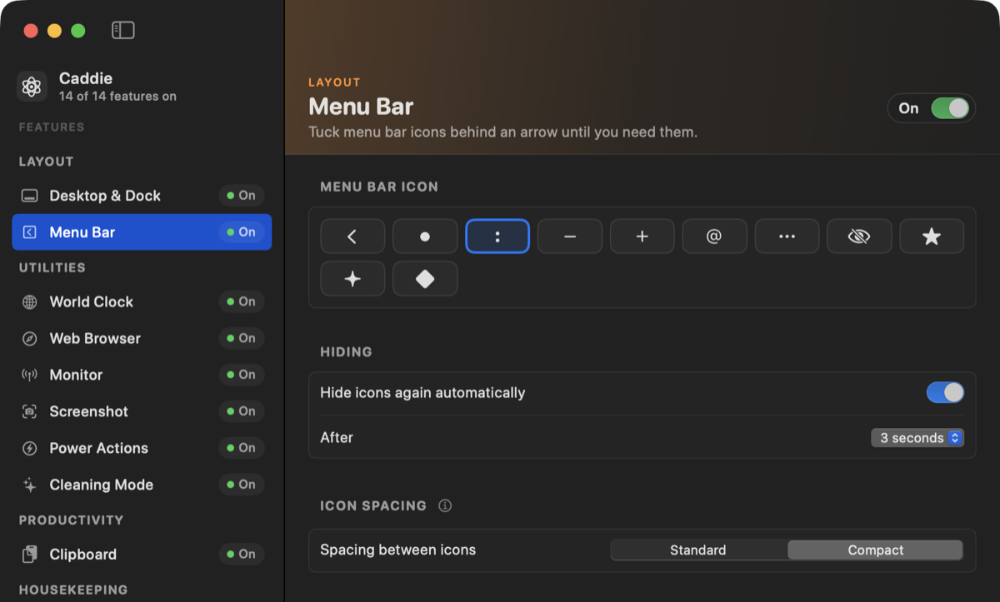
<ul><li>Sort menu bar icons into Shown, Hidden (revealed when you click the arrow) and Always Hidden (revealed with Option-click).</li><li>Icons can hide again by themselves after a few seconds.</li><li>Pick the arrow's look and switch between standard and compact spacing between icons.</li></ul>

<b>Dynamic Island</b> · music, your calendar and tools around the camera notch

 
<ul><li>Opens from the notch with widgets for what's playing, your calendar, notifications, downloads, a shelf for files, a scratchpad, a timer, a mirror and Caddie's tools. On a display without a notch it draws a stand-in.</li><li>Arrange its buttons down the sides and along the bottom, and add any Caddie action as a button.</li><li>The closed island shows music, a running timer or a download beside the notch, with optional indicators for the microphone, battery, clipboard, screenshots, a new track and more.</li><li>AI usage shows what Claude Code has used on this Mac: the session window, estimated spending, the trend, and the cost by model and by project. It reads Claude Code's local logs and sends nothing anywhere.</li></ul>

<b>Window Snap</b> · tile windows by dragging or with a shortcut

 
<ul><li>Drag a window to a screen edge or corner, or press a shortcut, for halves, quarters, thirds and two thirds, plus maximize, centre and restore.</li><li>Hover the green button for a menu of the same layouts, and optionally make a click fill the screen instead of entering full screen.</li><li>Change every layout's size and position, the edge areas that trigger it, the gap between windows and each shortcut.</li></ul>

### Utilities

<b>Monitor</b> · what your Mac is doing, under the Caddie icon

 
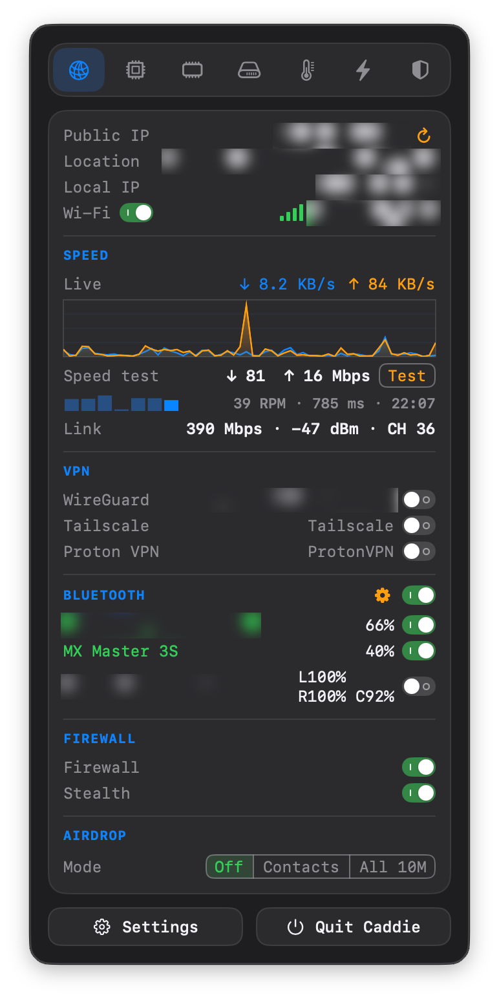
<ul><li>Click the Caddie icon for a panel with tabs for network, system and security.</li><li>Network: which apps are talking to the internet and where to, with the country of each connection (worked out on your Mac, offline).</li><li>System: CPU, memory, disk, battery and temperature.</li><li>Alerts such as "CPU usage above 90% for 5 minutes", shown as notifications.</li></ul>

<b>Security</b> · a score out of 100 and alerts when things change

 
<ul><li>A score for this Mac's protections: System Integrity Protection, FileVault, Gatekeeper, firewall, screen lock, secure boot, sharing services and AirDrop. Hover it to see what costs points.</li><li>Watched lists: what starts at login, system and kernel extensions, browser extensions, keyboard taps and trusted certificates. You're alerted when something is added.</li><li>When macOS blocks an app you downloaded, it shows up here with an <b>Allow</b> button, so you don't have to hunt for "Open Anyway" in System Settings.</li><li>Powered by <a href="https://osquery.io">osquery</a>, built into Caddie, so there's nothing extra to install.</li></ul>

<b>Screenshot</b> · capture, annotate, pin

 
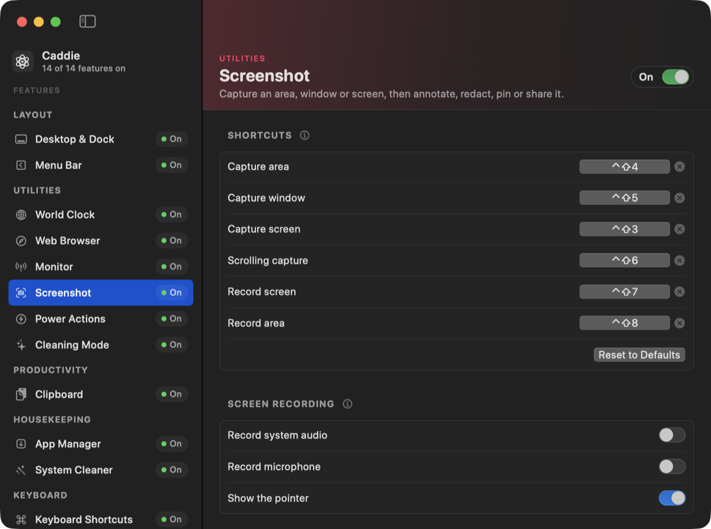
<ul><li>Shortcuts for an area, a window or the screen under the pointer, plus scrolling captures of long pages.</li><li>An editor for arrows, text, highlights, numbered steps and blur.</li><li>Pin a shot so it floats over your other windows, or copy and drag it anywhere.</li></ul>

<b>World Clock</b> · every city side by side

 
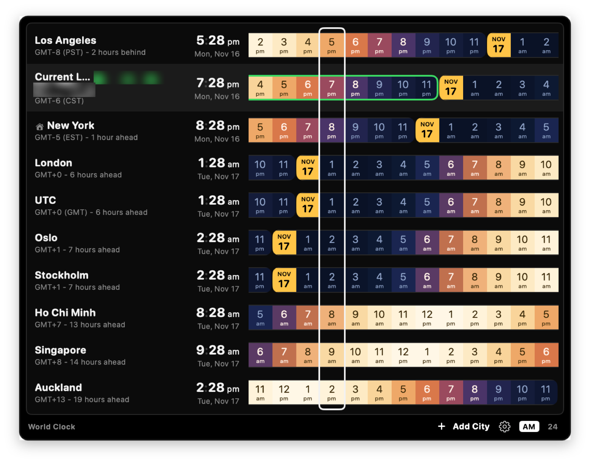
<ul><li>A globe in the menu bar opens your cities with a strip of hours lined up, so each column is the same moment. Hover a column to see every city at that hour.</li><li>Add any city, drag to reorder, and pick a home city, theme and font.</li></ul>

<b>Web Browser</b> · each link to the right browser

 
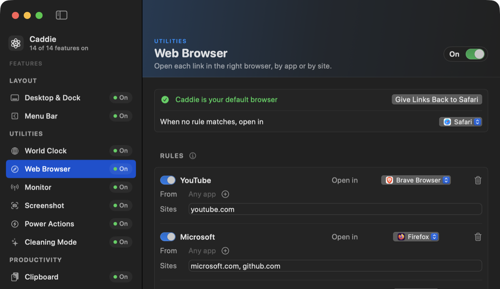
<ul><li>Caddie becomes your default browser and hands each link to a real one, chosen by the app the link was clicked in, the website, or both.</li><li>Hold ⌥ Option while clicking any link to pick the browser yourself.</li></ul>

<b>Power Actions</b> · more in Finder's right-click menu

 
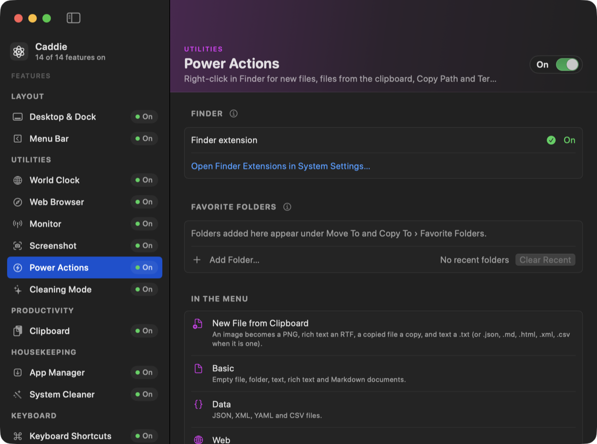
<ul><li>Right-click in a folder: New File, Open in Terminal, Copy Path and more.</li><li>Right-click files: Copy To and Move To your favourite folders, copy their paths, and more.</li><li>File previews: press Space in Finder on a Markdown, JSON, settings or code file to read it laid out and coloured.</li><li>Quick Edit: a button in the preview opens the file in a small editor, right where the preview was.</li></ul>

<b>Cleaning Mode</b> · wipe your keyboard and screen safely

 
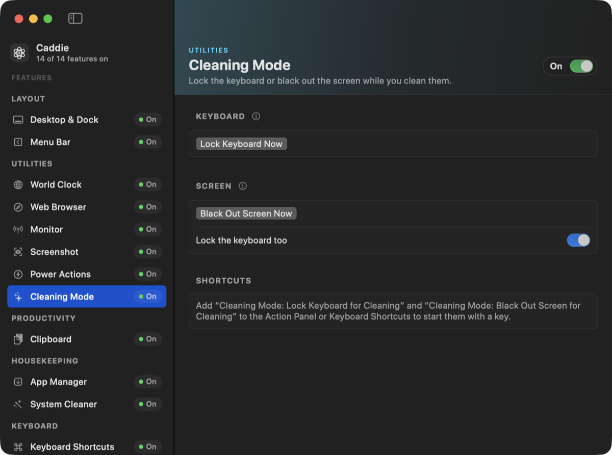
<ul><li>Locks the keyboard and blacks out the screen while you clean them, then gives them back.</li></ul>

<b>Keep Awake</b> · stop your Mac going to sleep

 
<ul><li>Keeps your Mac awake until you turn it off, or for a set time from 15 minutes to 8 hours, from Caddie's menu bar icon, a shortcut, or a button in Dynamic Island.</li><li>Can let the display turn off while the Mac keeps working, and turns itself off when the battery gets low. Closing a MacBook's lid still puts it to sleep.</li></ul>

### Productivity

<b>Timers</b> · work and break intervals with a break screen

 
<ul><li>Set up timers with a work length, short and long breaks, and a number of sessions. A break screen appears when it's time to rest.</li><li>Start one from the menu bar or from Dynamic Island's Timer widget, which also has a plain countdown and a stopwatch. The menu bar icon can be switched off.</li></ul>

<b>Clipboard</b> · history you can search and paste from

 
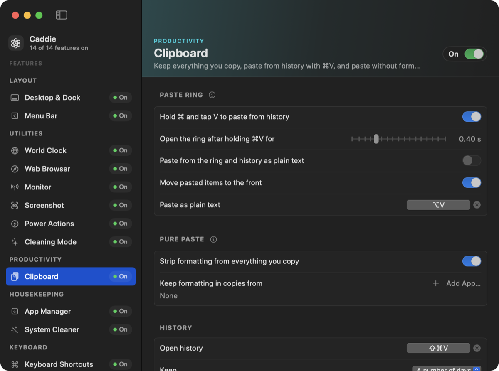
<ul><li>Keeps the text, links, images and files you copy, newest first, for as long or as many items as you choose.</li><li>Keep ⌘ held after ⌘V and a ring opens with search and filters, so you can paste anything from your history.</li><li>Pure Paste strips formatting. Nothing leaves your Mac.</li></ul>

<b>Action Panel</b> · your favourite actions, one key each

 
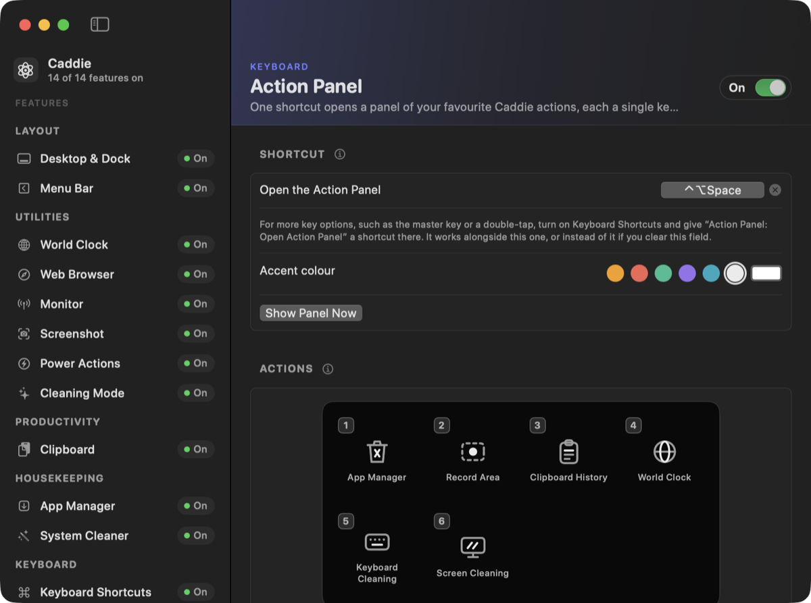
<ul><li>One shortcut opens a grid of actions from Caddie's features. Press a tile's key, use the arrow keys, or click.</li></ul>

### Housekeeping

<b>App Manager</b> · uninstall apps and keep them updated

 
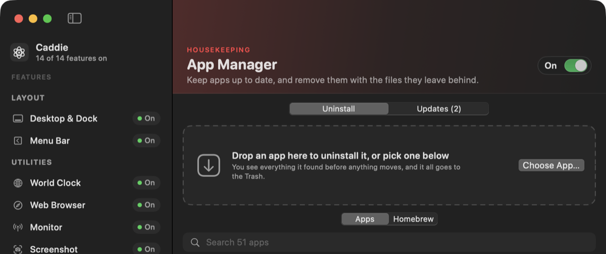
<ul><li><b>Uninstall:</b> drop an app in and Caddie lists it with the files it left in your Library (support files, caches, preferences, login items) and moves them all to the Trash.</li><li><b>Updates:</b> lists Homebrew and App Store apps that have new versions. Upgrade Homebrew apps with one click, or let Caddie upgrade them automatically.</li></ul>

<b>System Cleaner</b> · find space you can get back

 
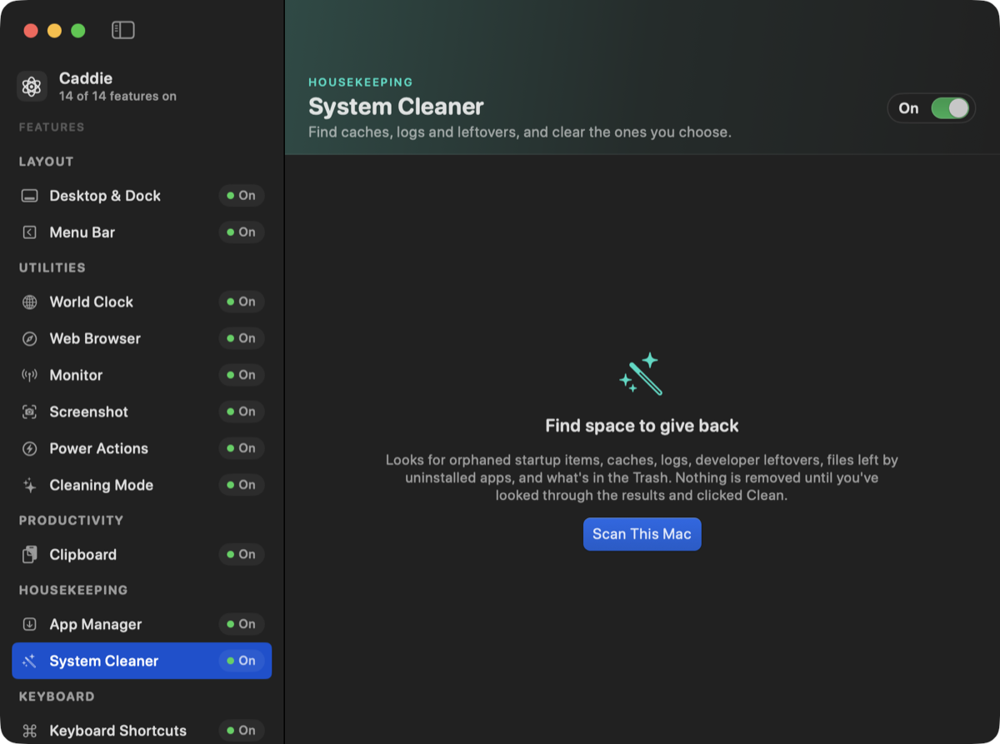
<ul><li>Scans caches, logs, leftovers from removed apps and more, listed by category, biggest first.</li><li>Nothing is removed until you choose; what you pick goes to the Trash.</li></ul>

### Keyboard

<b>Window Switcher</b> · switch between windows, not just apps

 
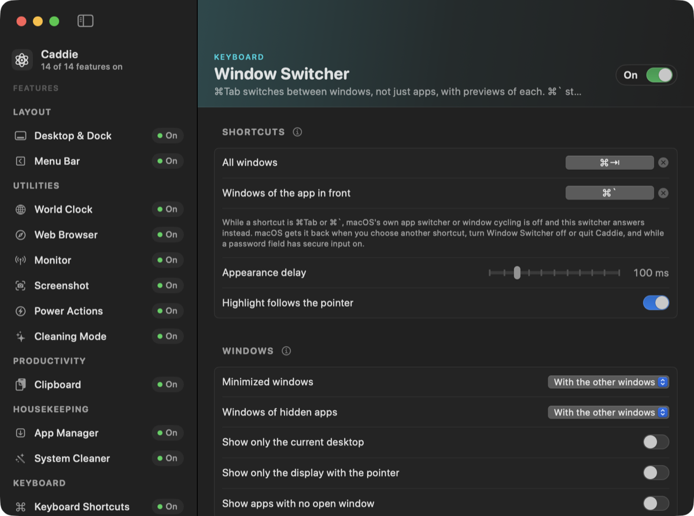
<ul><li>⌘Tab shows every window; ⌘` shows the windows of the app in front. Both shortcuts can be changed.</li><li>A quick tap flips between your last two windows.</li></ul>

<b>Keyboard Shortcuts</b> · a master key and double-taps

 
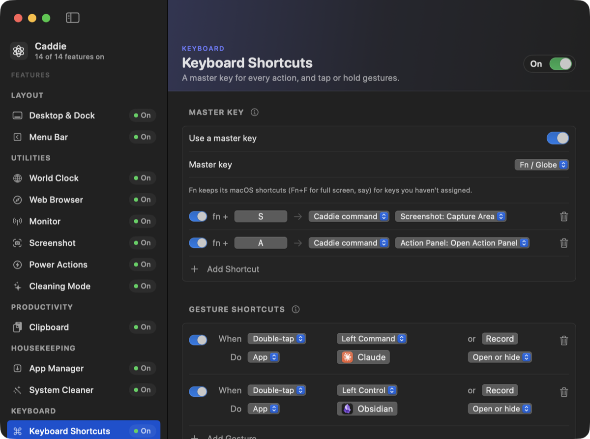
<ul><li>Turn Caps Lock (or another key) into a master key: hold it and press another key to open an app, a link, a file or any Caddie action.</li><li>Or trigger actions by double-tapping, triple-tapping or holding a modifier key.</li></ul>

### And

<b>Updates itself</b> · new versions install on their own

 
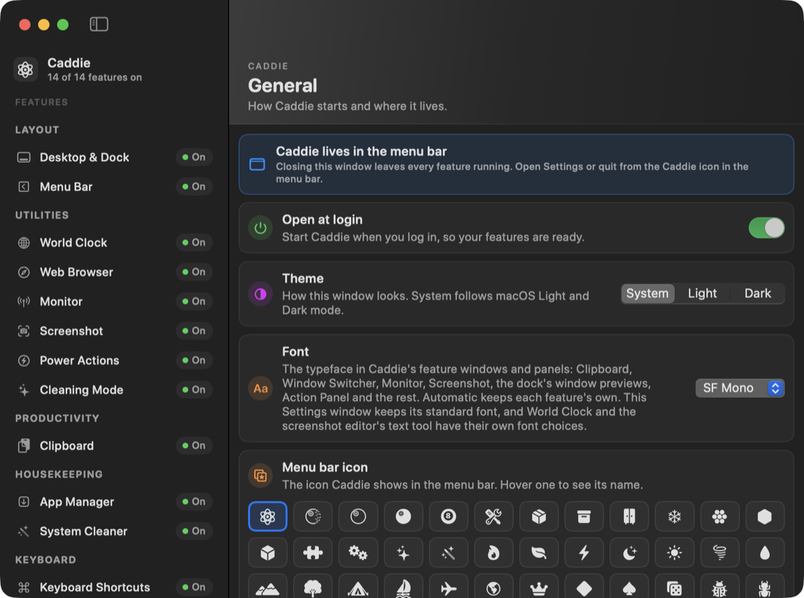
<ul><li>After an update, a What's New window lists what the version added.</li><li>Caddie checks this page's releases every few hours and installs new versions by itself, after checking each one is signed by the same developer. Turn it off in Settings → General to update by hand.</li></ul>

<b>Permissions page</b> · see what Caddie can access

 
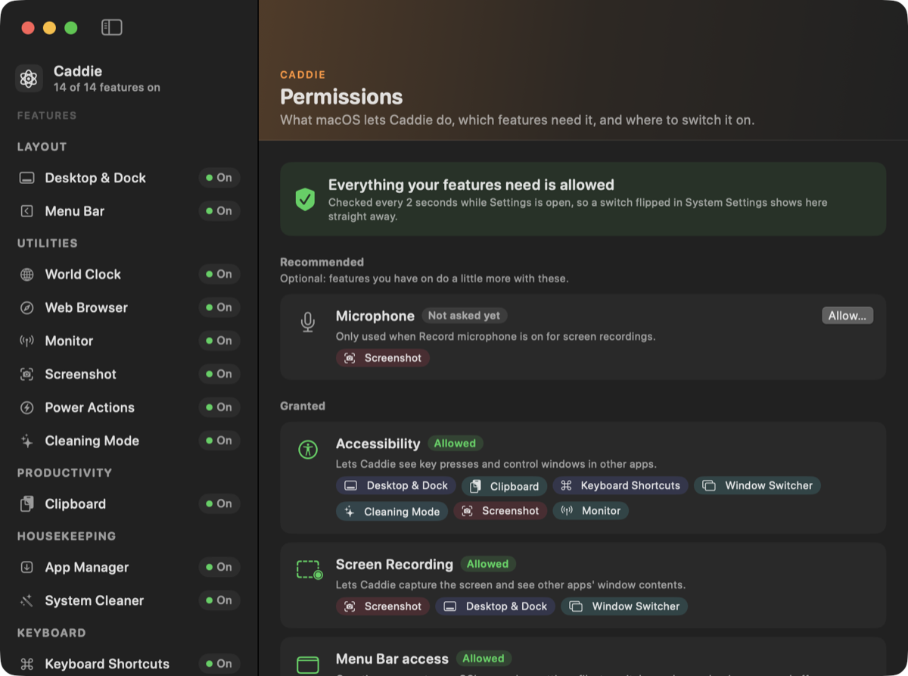
<ul><li>Lists every macOS permission Caddie can use, whether it's allowed, which features need it, and a button to allow it.</li></ul>

<b>Private</b> · no account, no analytics

 
<ul><li>Caddie uses the network only to check for updates and for the features you turn on that need it, like App Manager asking Homebrew for updates.</li></ul>

## Install

1. [Download Caddie.dmg](https://github.com/blackboxprojects/caddie/releases/latest/download/Caddie.dmg) and open it.
2. Drag **Caddie** onto the **Applications** shortcut, then open it from Applications. Caddie appears in your menu bar and opens its Settings.
3. **First launch:** Caddie isn't notarized by Apple, so macOS blocks it the first time. Click **Done**, then open **System Settings → Privacy & Security**, scroll to the message about Caddie, click **Open Anyway**, and confirm. You only do this once.

Turn on the features you want in Settings. If a feature needs a permission, such as Accessibility or Screen Recording, Caddie says which one and has a button to allow it.

## Updates

Caddie keeps itself up to date (Settings → General → App updates). Automatic updates are on by default; switch them off to check and install by hand. Older versions and release notes are on the [Releases](https://github.com/blackboxprojects/caddie/releases) page.

## Requirements

A Mac with Apple silicon (M1 or later) running macOS 14 Sonoma or later.

## Support

If Caddie saves you a few apps, you can buy me a coffee:

## Credits

Caddie includes [osquery](https://github.com/osquery/osquery) (Apache 2.0) and uses [DB-IP](https://db-ip.com) country data (CC BY 4.0) for Monitor's network view.
